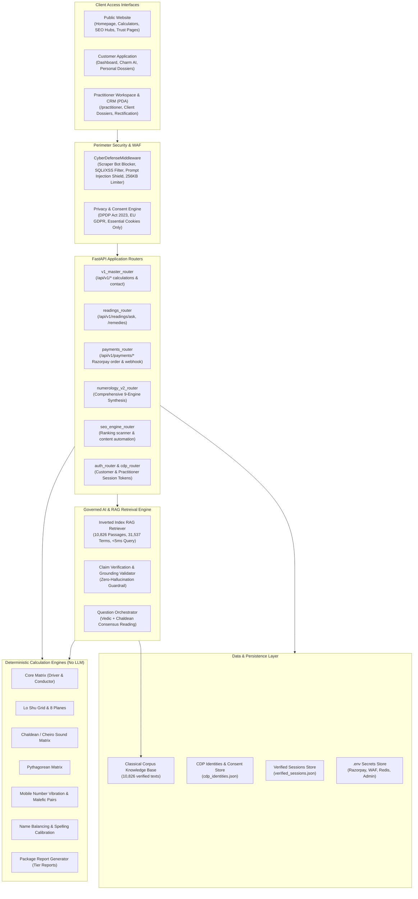
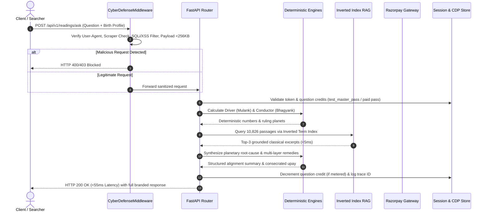

# Numeros Vision — Architecture Map & System Topology
**Repository:** `Numeros Vision (AI Numerology)`  
**Document ID:** `docs/audit/architecture-map.md`  
**Specification Reference:** `NUMEROS_VISION_MASTER_IMPLEMENTATION.md` Section 2  
**Brand Signature:** Numeros Vision | Unveil Every Charm

---

## 1. High-Level Logical Architecture

---

## 2. Component Boundaries & Responsibilities

### 2.1 Public Website Layer
- **Responsibility:** Discoverability, educational content, top-of-funnel lead generation, free instant diagnostics, and brand building.
- **Components:**
  - `app/static/index.html`: Unified homepage with instant hero Mulank/Bhagyank calculator, 9-layer preview, and Charm AI chat box.
  - `app/static/calculators.html` & specific tool pages: `/tools/name-balancing`, `/tools/mobile-numerology`, etc.
  - `app/static/blog/*.html` & `/blog/what-is-numerology`: High-authority SEO pillar guides and spoke articles.
  - Trust & Legal Pages: `/about`, `/methodology`, `/privacy`, `/terms`, `/refund-policy`, `/disclaimer`.

### 2.2 Customer Application Layer
- **Responsibility:** Post-calculation exploration, conversational querying, report purchasing, and profile preservation.
- **Components:**
  - `app/static/charm_ai.html`: Dedicated conversational AI portal backed by sub-55ms grounded RAG.
  - `app/static/dashboard.html`: Authenticated customer profile, saved calculation charts, and active question credits.
  - `app/static/sample2.html`: Mobile app preview demonstrating responsive luxury UI/UX and PWA compatibility.

### 2.3 Practitioner Workspace & CRM (PDA)
- **Responsibility:** B2B expert workstation for professional numerologists and consultants.
- **Components:**
  - `app/static/practitioner.html`: Multi-client management, Birth Time Rectification notes, personalized yantra drafting, and consultation scheduler.
  - `app/api/auth.py`: Practitioner credential validation, role checking (`practitioner`, `admin`).
  - `app/api/numerology_v2.py`: Deep 40-syllabus diagnostic outputs for professional clients.

### 2.4 Shared Application Services & Deterministic Engines
- **Responsibility:** Mathematical calculations that must NEVER hallucinate or fluctuate.
- **Rule:** 100% pure Python arithmetic without language model invocation.
- **Modules in `app/engine/`:**
  - `core_matrix.py`: Mulank (Driver, 1-9) and Bhagyank (Conductor, 1-9) calculation.
  - `cheiro_engine.py` & `chaldean_table.py`: Ancient Chaldean compound vibrations (10-52).
  - `pythagorean_engine.py`: Western reduction and master numbers (11, 22, 33).
  - `loshu_grid.py`: 3x3 Magic Square and 8 Planes analysis.
  - `name_balancer.py`: Calling name vs legal name vibrational harmonizer.
  - `package_report_generator.py`: Commercial multi-chapter dossier synthesis.

### 2.5 Governed RAG & AI Orchestrator
- **Responsibility:** Conversational synthesis, classical citations, planetary root-cause explanations, and consecrated remedies.
- **Modules:**
  - `rag_retriever.py`: Inverted index over 10,826 classical passages across 31,537 distinct terms with query caching (4.5ms lookup).
  - `consensus.py`: Multi-engine astrological consensus reading generator.
  - `ai_cost_and_security.py`: Section 15.4 deterministic gating, plan-based usage metering, and prompt injection defense.

### 2.6 Payment & Order Lifecycle
- **Responsibility:** Secure, idempotent commercial monetization.
- **Modules:**
  - `app/api/payments.py`: Razorpay order creation (`/create-order`), HMAC-SHA256 webhook signature verification (`/webhook`), session credit issuance (`consume_question`, `get_session_info`), and refund tracking.

---

## 3. End-to-End Request Lifecycle

---

## 4. Environment Configuration & Security Perimeter

- **Development/Staging:** `ENVIRONMENT=development`, test tokens enabled (`test_master_pass`), WAF actively enforcing all defenses.
- **Production Mode:** Strict origin restriction (`https://numerosvision.com`), test token bypass disabled, SSL/TLS termination, secure cookies, and no-server-header cloaking.
