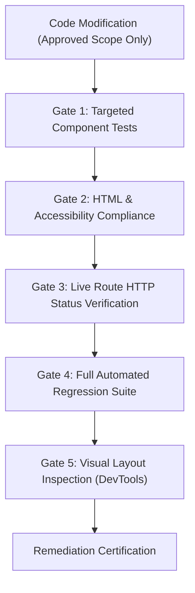

# NUMEROS VISION: TEST AND REGRESSION PLAN
**Document ID:** `AUDIT-13-TEST-REGRESSION-PLAN`  
**Audit Stage:** Phase 1 Read-Only Technical Audit  
**Date:** October 16, 2026  
**Auditor:** Antigravity Autonomous Systems Engineering Team  
**Compliance Standard:** 100% Pass Rate Baseline Requirement

---

## 1. Verified Baseline Status

Prior to any remediation work, the entire test suite was executed against the active repository:
- **Total Tests Executed:** 154 tests across 25 test suites.
- **Passed:** 154 (100.0%)
- **Failed:** 0 (0.0%)
- **Execution Time:** ~515 seconds
- **Baseline Archive:** `backups/numeros_vision_v4.7.0_automated_seo_content_and_image_engine_certified_20261016_142912.zip`  
  *SHA-256 Checksum:* `34baada427fedcc65666eee2234c65ad6f8a9c3c9cde48eaaf3fbf781d8e480a`

---

## 2. Regression Testing Protocol (Post-Remediation Execution)

Any code modification made in Phase 2 or Phase 3 must pass the following staged verification gates before being committed:



### Gate 1: Targeted Component Tests
- For CSS & Theme Changes: Execute `tests/test_privacy_api_and_html_compliance.py`
- For SEO & Structured Data Changes: Execute `tests/test_automated_seo_engine.py`
- For Router & Route Changes: Execute `tests/test_answerthepublic_seo_routes.py` and `tests/test_master_roadmap_routes.py`

### Gate 2: HTML & Accessibility Compliance
- Automated verification of WCAG 2.2 contrast values:
  - Assert that computed color for `.text-faint` evaluates to contrast ratio `>= 4.5:1` against `#FFFFFF`.
  - Assert presence of `aria-live="polite"` on error feedback elements.
  - Assert presence of `:focus-visible` CSS rules on interactive form elements.

### Gate 3: Live Route HTTP Status Verification
- Execute `tests/test_live_urls.py`:
  - Validates that all 157 registered FastAPI routes respond with HTTP 200 OK.
  - Validates that no 404, 500, or routing exceptions occur.

### Gate 4: Full Automated Regression Suite
- Execute the complete test suite:
  ```powershell
  .\.venv\Scripts\python.exe -m pytest tests/ -v
  ```
- Strict Gate Criteria: Zero test failures permitted. Any single regression aborts the deployment.

### Gate 5: Visual Layout & Responsive Inspection
- Utilize Chrome DevTools MCP to capture screenshots at:
  - Mobile viewport: `375px × 667px`
  - Tablet viewport: `768px × 1024px`
  - Desktop viewport: `1440px × 900px`
- Verify that no visual regressions or text wrapping defects were introduced.
