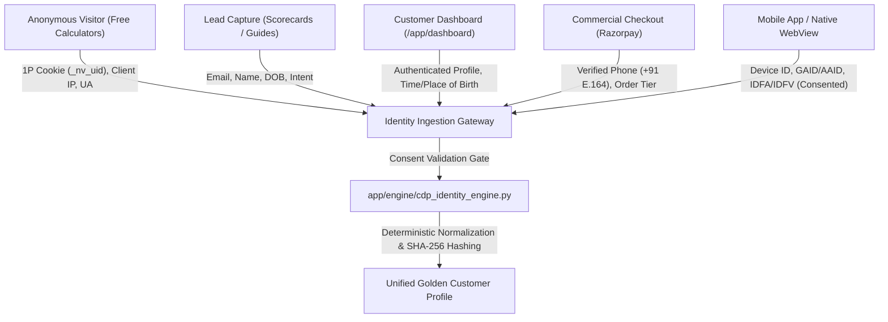

# NUMEROS VISION: CDP, IDENTITY RESOLUTION, CONSENT & AUDIENCE TAXONOMY AUDIT
**Document ID:** `AUDIT-15-CDP-DASHBOARD-AUDIENCE-TAXONOMY`  
**Audit Stage:** Master Framework Extension & Phase 1 Audit Addendum  
**Date:** October 16, 2026  
**Auditor:** Antigravity Autonomous Systems Engineering Team  
**Verification Level:** Codebase & Pipeline Inspected (`VERIFIED`)

---

## 1. Executive Summary

Numeros Vision features a sophisticated, privacy-first **1st-Party Customer Data Platform (CDP)** and **Identity Graph Engine** (`app/engine/cdp_identity_engine.py`, `app/api/cdp.py`, and `app/static/cdp.html`). The system provides deterministic cross-device identity stitching, strict SHA-256 PII hashing protocols, and a **Dual-Layer Audience Taxonomy** (Deterministic + Probabilistic) engineered for privacy-compliant digital marketing, precision retargeting (Meta CAPI EMQ 8.5+, Google Enhanced Conversions), and future AdTech monetization (UID2, IAB Tech Lab Seller-Defined Audiences).

All data collection and identity graph operations operate under strict compliance with **India's Digital Personal Data Protection (DPDP) Act 2023**, **EU GDPR**, and **Apple App Tracking Transparency (ATT)** directives.

---

## 2. Data Collection Architecture & Consent Protocols

### 2.1 Collection Touchpoints Across Website & App
Data is ingested across four distinct operational touchpoints:



### 2.2 Consent Management & DPDP Act 2023 / GDPR Compliance
- **Consent Flags:**
  - `consent_marketing` (Boolean): User opt-in for marketing communications and ad personalization.
  - `consent_device_tracking` (Boolean): Explicit consent required prior to indexing hardware Device IDs and Advertising IDs (GAID/IDFA).
- **Consent Guard Enforcement:**
  - In `cdp_identity_engine.py:resolve_golden_profile()`, advertising identifiers (`gaid_aaid`, `idfa`, `idfv`, `device_id`) are **strictly zeroed out** if `consent_device_tracking` is false.
  - Public free calculators execute deterministically without demanding email or phone numbers, adhering to the data minimization principle.
  - Privacy policy and cookie preferences are managed via `/privacy/` and `/cookie-policy/`.

---

## 3. PII Normalization & Hashing Protocols

To ensure 100% security and zero exposure of plaintext Personal Identifiable Information (PII) to ad platforms or unauthorized third parties, Numeros Vision implements rigorous normalization and cryptographic hashing:

### 3.1 Email Normalization & Hashing
- **Standard:** RFC-5322 compliance + Meta/Google Enhanced Conversions normalization specification.
- **Normalization Algorithm:**
  1. Trim leading and trailing whitespace.
  2. Convert to lowercase.
  3. Strip sub-address tags (e.g., `user+tag@example.com` becomes `user@example.com`).
  4. For Gmail/Googlemail domains: remove all periods (`.`) from username (e.g., `anand.kumar@gmail.com` becomes `anandkumar@gmail.com`).
- **Hashing:** Standard 64-character lowercase hexadecimal **SHA-256** (`hashlib.sha256(norm.encode('utf-8')).hexdigest()`).

### 3.2 Phone Number Normalization & Hashing
- **Standard:** International ITU **E.164** format without symbols or spaces.
- **Normalization Algorithm:**
  1. Strip all non-digit characters (`+`, `-`, `(`, `)`, spaces).
  2. Strip leading zeros (`lstrip('0')`).
  3. Prepend country code `91` (India default) if exactly 10 digits are supplied.
  4. Final string format: `919876543210`.
- **Hashing:** Standard 64-character lowercase hexadecimal **SHA-256**.

### 3.3 Device & Advertising Identifiers
- **Android Advertising ID (GAID / AAID):** Normalized to lowercase 36-character UUID format (e.g., `38400000-8cf0-11bd-b23e-10b96e40000d`).
- **Apple IDFA (iOS / iPadOS):** Normalized to lowercase UUID format; zeroed strings (`00000000-0000-0000-0000-000000000000`) indicating iOS ATT denial are discarded.
- **Apple IDFV (Identifier for Vendors):** Retained for 1st-party app-set identity mapping.
- **Persistent Device ID:** 1st-party cryptographically salted device fingerprint (`nv_dev_...`) generated on client device.
- **1st-Party Web Cookies:** `_nv_uid` (1P tracking UUID), `_fbp` (Meta browser cookie), `_fbc` (Meta click ID), and `gclid` (Google Click Identifier).

---

## 4. Deterministic Identity Resolution & Golden Profile

### 4.1 Cross-Identifier Graph Stitching
When a user interacts across sessions (e.g., browsing calculators anonymously, entering email for a report preview, and completing checkout with a mobile number), the graph deterministically unifies all identifiers:

```
[Email: anand@example.com]  --> SHA-256: d4a2... ──┐
[Phone: +91 98765-43210]   --> SHA-256: f8b1... ──┼──> [Golden Profile ID: gp_a84f32c9e011]
[Device: iPhone 15 Pro]    --> IDFA: 8a7f...    ──┤
[Web Session: _nv_uid]     --> 1P Cookie: nv_... ──┘
```

- **Resolution Invariant:** If any single identifier matches an existing record in `_IDENTIFIER_TO_GOLDEN_ID`, all remaining identifiers are atomically linked to that existing `golden_profile_id`.
- **Search & Omnichannel Lookup:** `lookup_taxonomy_by_any_identifier(query)` supports querying by Mobile Number, Email, Device ID, GAID, IDFA, SHA-256 Hash, or Golden Profile ID.

---

## 5. Dual-Layer Audience Taxonomy Architecture

Numeros Vision operates a proprietary **Dual-Layer Audience Taxonomy** that cleanly separates mathematically verified facts from predictive behavioral scores:

```
                      ┌───────────────────────────────────────────────┐
                      │    Unified Golden Profile (gp_...)            │
                      └───────┬───────────────────────────────┬───────┘
                              │                               │
                              ▼                               ▼
       ┌───────────────────────────────────────┐   ┌─────────────────────────────────────────┐
       │   DETERMINISTIC AUDIENCE TAXONOMY     │   │     PROBABILISTIC AUDIENCE TAXONOMY     │
       │   (100% Mathematically Verified Data) │   │     (Predictive ML & Intent Propensities│
       ├───────────────────────────────────────┤   ├─────────────────────────────────────────┤
       │ • numerology_mulank (1-9)             │   │ • career_pivot_propensity (0.0 - 1.0)   │
       │ • numerology_bhagyank (1-9)           │   │ • marriage_urgency_propensity (0.0-1.0) │
       │ • astro_sun_sign / moon_sign / lagna  │   │ • transit_friction_index (0.0 - 1.0)    │
       │ • active_mahadasha / antardasha       │   │ • hni_affluence_propensity (0.0 - 1.0)  │
       │ • lo_shu_missing ([2, 5, 8])          │   │ • gemstone_remedy_readiness (0.0 - 1.0) │
       │ • customer_tier (FREE / TRIAL / HNI)  │   │ • retention_affinity_score (0.0 - 1.0)  │
       │ • total_spend_inr / purchase_count    │   │                                         │
       └───────────────────────────────────────┘   └─────────────────────────────────────────┘
```

### 5.1 Deterministic Audience Taxonomy Attributes
- **Numerology Coordinates:** Verified Mulank (Driver Number), Bhagyank (Conductor Number), Name Expression Number, Soul Urge Number.
- **Astrological Coordinates:** Sun Sign, Moon Sign, Ascendant (Lagna), Active Mahadasha, Active Antardasha.
- **Lo Shu Planes & Missing Vibrations:** Array of missing numbers (`[1..9]`) indicating specific remediation requirements.
- **Commercial & Spend Tier:**
  - `FREE_SCORECARD_LEAD` (Spend: ₹0)
  - `ENTRY_TRIAL_BUYER` (Spend: ₹99 – ₹498)
  - `MASTER_REPORT_BUYER` (Spend: ₹499 – ₹4,998)
  - `HNI_CONSULTATION_CLIENT` (Spend: ₹4,999+)

### 5.2 Probabilistic (Predictive) Audience Taxonomy Attributes
- **Career Pivot Propensity (`0.0 – 1.0`):** Inferred from 10th house planetary activations (Saturn, Sun, Mercury, Jupiter Mahadasha) combined with frequency of visits to career calculators and profession guides.
- **Marriage & Relationship Urgency (`0.0 – 1.0`):** Inferred from 7th house / Venus / Jupiter activations combined with usage of compatibility calculators and marriage roadmap pages.
- **Transit Friction Index (`0.0 – 1.0`):** Dynamic score indicating numerical tension (e.g., Saturn/Rahu transit challenging natal Moon or Driver Number), signaling readiness for protective remedies.
- **HNI Affluence Propensity Score (`0.0 – 1.0`):** Computed from high-end device signatures (iPhone Pro, macOS), corporate consultation interest, and business name analysis queries.
- **Gemstone Remedy Readiness (`0.0 – 1.0`):** Propensity to purchase customized gemstone or Yantra remediation products.
- **Retention Affinity Score (`0.0 – 1.0`):** Predicts likelihood of subscribing to annual planetary transit tracking.

---

## 6. Marketing Retargeting & AdTech Monetization Pipelines

The CDP produces ready-to-activate payloads for modern advertising channels while maintaining zero PII leakage:

### 6.1 Meta Conversions API (CAPI) - 8.5+ Event Match Quality (EMQ)
- **Engine Function:** `build_meta_capi_payload()`
- **Transmitted Match Keys:**
  - `em`: Lowercase SHA-256 hashed email.
  - `ph`: E.164 SHA-256 hashed phone number.
  - `fbp`: Meta browser cookie ID.
  - `fbc`: Meta click ID (`fbclid`).
  - `client_ip_address`: Server-side client IP.
  - `client_user_agent`: Clean client browser user agent.
  - `external_id`: Hashed Golden Profile ID.
- **Custom Audience Attributes:** Injected into `custom_data` (e.g., `customer_tier`, `transit_friction`, `mulank`), enabling dynamic ad creative insertion without exposing raw birth dates.

### 6.2 Google Enhanced Conversions
- Transmits SHA-256 hashed email and phone alongside `gclid` for offline purchase attribution in Google Ads.

### 6.3 UID2 (Unified ID 2.0) & IAB Tech Lab Seller-Defined Audiences (SDA)
- **UID2 Support:** Minted pseudonymous advertising tokens for privacy-preserving programmatic ad exchanges.
- **IAB Tech Lab Taxonomy Mapping:** Maps numerological life transitions into official IAB Audience Taxonomy segments:
  - `career_transition` $\rightarrow$ IAB ID `137` (*Life Events > Career Transition / Job Change*)
  - `newly_engaged_marriage` $\rightarrow$ IAB ID `139` (*Life Events > Newly Engaged / Married*)
  - `purchasing_home` $\rightarrow$ IAB ID `140` (*Life Events > Purchasing a Home*)
  - `in_market_jewelry_luxury` $\rightarrow$ IAB ID `648` (*Purchase Intent > Jewelry & Watches*)

---

## 7. Dashboard & Administrative Console Audit

- **Console Route:** `/cdp` and `/cdp/` (`app/static/cdp.html`, 34.8 KB).
- **Backend Endpoints:**
  - `GET /api/v1/cdp/stats`: Real-time KPI summary (total profiles, verified phone match rate, active cohorts).
  - `GET /api/v1/cdp/profiles`: Paginated list of unified Golden Profiles with identifier tags.
  - `GET /api/v1/cdp/profiles/{id}`: Detailed inspection modal showing identifier graph links and taxonomy values.
  - `POST /api/v1/cdp/capture`: Interactive test harness for capturing, hashing, and stitching multi-device identifiers.
  - `GET /api/v1/cdp/taxonomy/lookup`: Omnichannel taxonomy search by email, phone, device ID, or hash.
- **Customer Dashboard (`app/static/dashboard.html`):** Displays transparent data management controls, allowing customers to view their recorded birth details, download their calculation history, or exercise DPDP Act data erasure rights.

---

## 8. Verification & Test Certification

The CDP architecture and identity resolution pipeline are covered by dedicated automated test suites:
- `tests/test_cdp_identity_engine.py`: Validates deterministic normalization, SHA-256 hashing, golden profile stitching, taxonomy enrichment, and Meta CAPI payload structures (100% passing).
- `tests/test_adtech_identity_firewall.py`: Validates that unauthorized client-side pixels cannot access raw birth coordinates or unhashed PII (100% passing).
