# Numeros Vision — Technical SEO & Content Baseline Audit
**Repository:** `Numeros Vision (AI Numerology)`  
**Document ID:** `docs/audit/seo-baseline.md`  
**Specification Reference:** `NUMEROS_VISION_MASTER_IMPLEMENTATION.md` Section 5, 7, 8  
**Data Reference:** `configuration/search_intent_and_30day_content_plan.csv`  
**Brand Signature:** Numeros Vision | Unveil Every Charm

---

## 1. SEO Executive Summary

Numeros Vision operates in a high-demand, high-intent search ecosystem. An analysis of 433 cleaned unique keywords across 17 distinct clusters from AnswerThePublic search intelligence reveals:
- **Total Search Volume (India, Google):** **3,284,050 searches / month**.
- **Intent Distribution:**
  - **Transactional (82.9% / 2,723,130 searches/mo):** Users seeking interactive calculators, instant name audits, core number reductions, and lead-generation reports.
  - **Informational (16.5% / 541,660 searches/mo):** Users seeking deep explanations of number meanings, history, systems differences (*Chaldean vs Pythagorean vs Vedic*), and planetary roots.
  - **Commercial (0.5% / 17,200 searches/mo):** High-CPC intent seeking paid name corrections, business branding, 1-on-1 consultations, courses, books, and gemstone/yantra remedies.
  - **Navigational (0.06% / 2,060 searches/mo):** Competitor and author noise; strategically addressed in comparative roundups rather than dedicated target pages.

---

## 2. 17-Cluster Topical Authority Architecture

| Cluster ID | Topic Cluster Name | Cleaned Keywords | Peak Single Keyword | Monthly Search Volume | Primary Roadmap Anchor | Intent Profile |
|---|---|---|---|---|---|---|
| **C01** | Name Numerology | 35 | `numerology calculator by name` (201K) | 2,276,080 | R02, R03, R26 | Transactional / Tool |
| **C02** | Calculators (Master Hub) | 20 | `numerology calculator` (135K) | 169,530 | R01 | Transactional / Hub |
| **C03** | Date of Birth & Core Numbers | 35 | `numerology calculator by date of birth` (12.1K) | 124,140 | R07, R09 | Transactional / Tool |
| **C04** | Number Meanings (0-9, 24, Master) | 56 | `numerology number` (33.1K) | 298,510 | R06, R10–R20 | Informational / Spokes |
| **C05** | Alphabet & Letter Values | 13 | `numerology alphabet number` (14.8K) | 104,240 | R05 | Informational / Chart |
| **C06** | What is Numerology & Credibility | 39 | `numerology` (74K) | 83,050 | R34, R35 | Informational / Master Pillar |
| **C07** | Mobile, Vehicle & House Numbers | 23 | `numerology mobile number` (8.1K) | 52,800 | R24, R25, R27 | Transactional / Tool |
| **C08** | Business & Brand Names | 8 | `numerology calculator company name` (12.1K) | 35,830 | R23, R28 | Commercial ($0.85 CPC) |
| **C09** | Systems (Chaldean, Pythagorean, Vedic)| 24 | `chaldean numerology calculator` (9.9K) | 35,520 | R22, R30, R31 | Educational / Tool |
| **C10** | Lo Shu Grid & Numerology Chart | 6 | `numerology chart` (27.1K) | 32,080 | R08 | Transactional / Grid |
| **C11** | Regional Languages (Hindi, Tamil, Telugu)| 21 | `numerology hindi meaning` (2.9K) | 18,420 | R36, R37, R38 | Regional Hubs |
| **C12** | Best & Lucky Numbers | 9 | `numerology which number is best` (3.6K) | 16,410 | R21 | Informational / Guidance |
| **C13** | Reports & Local Services | 14 | `numerology near me` (6.6K) | 14,480 | R04, R42 | Commercial / Lead-Gen |
| **C14** | Predictions, Daily & Personal Year | 15 | `numerology predictions` (2.4K) | 7,820 | R32, R33 | Seasonal / Daily |
| **C15** | Learn Numerology & Books | 23 | `numerology book` (2.9K) | 8,060 | R39, R40 | Commercial / Educational |
| **C16** | Remedies & Products | 17 | `numerology yantra` (720) | 1,330 | R41 | Commercial / E-Commerce |
| **C17** | Glossary & Knowledge Base | 4 | `numerology keywords` (10) | 150 | R43 | Knowledge Hub |

---

## 3. 30-Day Content Roadmap & URL Mapping

The 43 high-priority pages are structured to build impenetrable topical authority in 30 days:

```mermaid
graph TD
    R34["R34: /what-is-numerology/ (Master Pillar · 3,200 words)"]
    R01["R01: /numerology-calculator/ (Master Tool Hub)"]
    R04["R04: /numerology-report/ (Primary Conversion Money Page)"]

    R03["R03: /name-numerology/ (Pillar)"]
    R06["R06: /numerology-numbers/ (Pillar)"]
    R22["R22: /chaldean-numerology/ (Core Specialty)"]
    R23["R23: /business-name-numerology/ (High CPC Money Page)"]
    R24["R24: /mobile-number-numerology/ (Tool Pillar)"]
    R08["R08: /numerology-chart-lo-shu-grid/ (Expert Grid)"]
    
    R34 --> R01
    R34 --> R04
    R34 --> R03
    R34 --> R06
    R34 --> R22
    R34 --> R23
    R34 --> R24
    R34 --> R08
    
    R01 --> R04
    R03 --> R02["R02: /numerology-calculator-by-name/"]
    R03 --> R26["R26: /lucky-name-numerology-name-correction/"]
    R06 --> R10toR18["R10-R18: Number Pages (1 to 9)"]
    R06 --> R19["R19: /master-numbers-0-10-11-22/"]
    R06 --> R20["R20: /numerology-number-24/"]
    R07["R07: /numerology-calculator-by-date-of-birth/"] --> R04
    R29["R29: /numerology-compatibility-calculator/"] --> R04
    R42["R42: /numerologist-near-me/"] --> R04
```

### 3.1 10 Non-Negotiable Internal Linking Rules
1. **Hub and Spoke:** `R34` is the Master Pillar. Cluster pillars (`R03`, `R06`, `R24`, `R23`) sit under it. Every spoke links up to its pillar, and the pillar links down to every spoke.
2. **Every Guide Points to a Tool:** Every informational guide features a top calculator CTA and an end CTA.
3. **Every Tool Points Back to a Guide:** Results feature a "Learn what this vibration means" contextual link.
4. **One Money Page (`R04`):** All tools and number pages funnel to `R04: /numerology-report/` with clean commercial anchor text.
5. **Number Chain:** Pages 1 through 9 link prev/next to each other, back to `R06`, and to `R29` compatibility.
6. **Natural Anchor Text:** Primary keyword for the parent link, natural variation for CTAs; no repetitive spamming.
7. **Link Count Guard:** 5 to 12 contextual internal links per page; minimum 3 inbound links per page (zero orphans).
8. **Chronological Rollout:** Early pages link to existing routes; missing links reconciled on Day 30 (`R43`).
9. **Regional Language Flow:** Hindi (`R36`), Tamil (`R37`), and Telugu (`R38`) link to English tools (`R02`, `R07`).
10. **Disciplined Navigation Menu:** 6 items maximum: Calculators (`R01`) | Numbers (`R06`) | Name (`R03`) | Business (`R23`) | Learn (`R34`) | Reports (`R04`).

---

## 4. Current Technical SEO Infrastructure Audit

| Technical Component | Specification Requirement | Live Implementation Status | Audit Verification |
|---|---|---|---|
| **Canonical URLs** | Self-referencing, absolute, trailing-slash consistent | Fully implemented across all templates (`https://numerosvision.com/...`) | Verified |
| **Open Graph & Twitter Cards** | Complete OG title, description, image, type, and locale | Verified in `<head>` across all pages | Verified |
| **XML Sitemap** | Served dynamically at `/sitemap.xml` with priority and changefreq | Active at `/sitemap.xml` (HTTP 200 OK) | Verified |
| **Robots Directives** | Allow public routes, disallow `/admin/`, `/app/`, `/checkout/` | Active at `/robots.txt` with sitemap reference | Verified |
| **LLM & AI Agent Directives** | `llms.txt` active for AI search engine discovery | Active at `/llms.txt` (HTTP 200 OK) | Verified |
| **JSON-LD Schema** | Valid `Organization`, `WebSite`, `BreadcrumbList`, `SoftwareApplication` | Structured schema on all calculator and guide pages | Verified |
| **Mobile & Viewport** | Responsive meta viewport, PWA manifest, Apple touch icon | Full PWA `manifest.json` and `sw.js` registered | Verified |
| **Accessibility (WCAG 2.2)** | Semantic headings (`<h1>` to `<h3>`), high contrast, aria labels | Zero unlabelled inputs, contrast > 4.5:1 | Verified |
