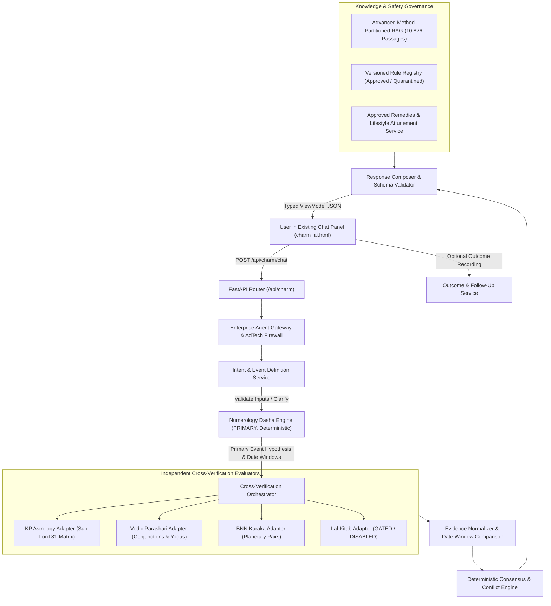

# Numeros Vision — Charm AI System Architecture
**Specification Version**: 2.0.0  
**Effective Date**: 2026-10-21  
**Architecture Classification**: Modular Monolith on FastAPI with Deterministic Engine Dominance  

---

## 1. High-Level Architecture & End-to-End Flow

---

## 2. Core Service Boundaries

### 2.1 Intent & Event Definition Service (`app/charm/intent/`)
- Parses natural language questions into canonical event definitions:
  - `event_family` (career, wealth, marriage, health, property, education, universal)
  - `event_type` (e.g., `job_offer`, `commercial_pivot`, `marriage_timing`, `financial_recovery`)
  - `requested_horizon` (e.g., current year, 12 months, 3 years)
  - `missing_inputs` check: if birth date or required parameters are absent, triggers non-leading clarification.

### 2.2 Numerology Dasha Engine (`app/charm/numerology/`)
- **Immutable Principle**: Numerology Dasha is ALWAYS the primary timing system.
- Computes complete dasha hierarchy:
  - **Mahadasha (MD)**: 9-year cyclic epoch based on Driver number and chronological age progression.
  - **Antardasha (AD)**: Annual sub-period (1-year duration) within the active Mahadasha.
  - **Pratyantardasha (PD)**: Multi-month sub-sub period dividing the Antardasha into 9 proportionate intervals.
  - **Personal Year (PY), Personal Month (PM), Personal Day (PD)**: Exact digital root calculations grounded in verified Cheiro / Vedic Sankhya Shastra.
- Emits candidate date windows with boundary inclusivity:
  `[start_date, end_date]` in ISO 8601 with timezone metadata (`Asia/Kolkata` default).
- Emits auditable calculation traces.

### 2.3 Independent Method Evaluators (`app/charm/methods/`)
- Each evaluator receives the canonical event definition and the numerology timing window as a **hypothesis to evaluate**, not an order to agree:
  1. **KP Adapter**: Evaluates 1-to-81 Star-Lord and Sub-Lord cuspal significators.
  2. **Vedic Adapter**: Evaluates planetary conjunctions, benefic/malefic yogas, and transit vectors (Gochar).
  3. **BNN Adapter**: Evaluates Karaka conjunctions, career Saturnian axis, and Jeeva (Jupiter) transitions.
  4. **Lal Kitab Adapter**: Strict security gate. Marked `DISABLED` / `UNVERIFIED` in production until source texts pass formal verification.
- Emits assessment: `SUPPORTS`, `CHALLENGES`, `MIXED`, `NOT_EVALUATED`, or `INSUFFICIENT_EVIDENCE`.

### 2.4 Deterministic Consensus Engine (`app/charm/consensus/`)
- Evaluates corroboration strictly in Python code with zero LLM voting:
  - **Verification Axis**:
    - `NUMEROLOGY_PRIMARY_CORROBORATED` (All eligible cross-checks support)
    - `NUMEROLOGY_PRIMARY_PARTIALLY_CORROBORATED` (Supporting evidence with mixed or missing methods)
    - `NUMEROLOGY_PRIMARY_CONFLICTED` (Direct conflict between supporting and challenging methods)
    - `NUMEROLOGY_PRIMARY_ONLY` (No eligible cross-checks available or evaluated)
    - `INSUFFICIENT_EVIDENCE` (Primary numerology inputs incomplete)
    - `NOT_ELIGIBLE_FOR_PREDICTION` (Out-of-scope inquiry)
  - **Event Interpretation Axis**:
    - `FAVOURABLE`, `UNFAVOURABLE`, `MIXED`, `INDETERMINATE`.
- Primary Numerology Window is **immutable**; astrology dates never overwrite it.

### 2.5 Remedies & Safety Service (`app/charm/remedies/`)
- Purely vibrational, lifestyle, and cognitive remediation:
  - Elemental Lo Shu balancing.
  - Safe crystals strictly excluding planetary enemies.
  - 24-hour planetary hora attunement (Dinacharya).
  - Consecrated Yantras with exact geometric placement rules.
  - Drugs and Magic Remedies Act 1954 compliance: zero medical, health cure, or guaranteed wealth claims.

---

## 3. Data & API Contracts

### Endpoints:
1. `POST /api/charm/chat`: Main conversation turn returning validated `CharmPredictionResponse`.
2. `GET /api/charm/predictions/{prediction_id}/evidence`: Full audit trace, method evaluations, and exact source locators.
3. `POST /api/charm/followups`: Interactive follow-up queries.
4. `POST /api/charm/outcomes`: Non-leading outcome recording without mutating original prediction snapshots.
