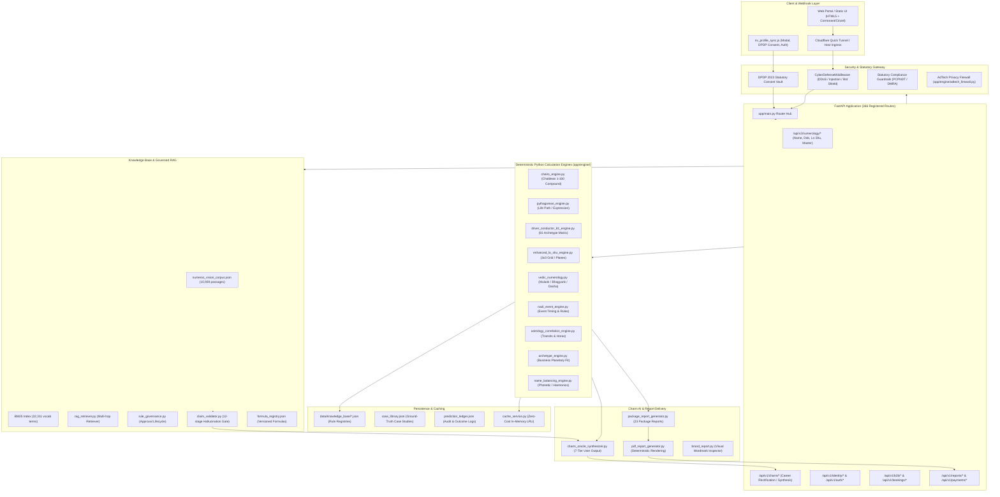

# NUMEROS VISION & CHARM AI — BASELINE SYSTEM AUDIT & ARCHITECTURAL BLUEPRINT
**Document Version**: 2.0.0  
**Audit Date**: 2026-10-29  
**Execution Environment**: Windows 11 / Python 3.14 / FastAPI / Uvicorn  
**Master Standard**: `Numeros_Vision_Google_Antigravity_Master_Implementation_v2.md` & `AGENTS.md`

---

## 1. Executive Summary & Audit Scope

This baseline audit evaluates the complete state of the **Numeros Vision** and **Charm AI** production repository prior to additive, versioned implementation of Master Implementation Specification v2.0.

### Audit Objectives
1. Perform an end-to-end inspection of codebase architecture, runtime dependencies, persistence models, backend API routes, calculation engines, frontend assets, RAG retriever, Charm AI synthesizers, report generators, and security firewalls.
2. Verify existing behavior and ensure that **zero breaking changes** or unauthorized mutations occur.
3. Quantify baseline test performance across all 60 test suites and document pre-existing test discrepancies.
4. Establish the exact provenance, page count, and text-extractability status of all 10 uploaded reference PDF files (6 distinct titles, 4 duplicates).
5. Lay down a phased, deterministic implementation roadmap that strictly adheres to the core directives:
   - **Deterministic Engine Authority**: 100% of calculations owned by Python engines (`app/engine/`).
   - **Zero Rule Fabrication**: Unapproved or ambiguous traditions remain `UNCONFIGURED` or `DRAFT`.
   - **Unknown Is Not Negative**: Missing inputs trigger explicit `INSUFFICIENT_EVIDENCE` or `UNKNOWN`.
   - **Mandatory Evidence Labeling**: Strict separation between deterministic findings, traditional interpretations, commercial evidence, and speculative hypotheses.
   - **Brand Theme Integrity**: Zero raw black `#000000`, Jupiter Gold (`#C9A227`, `#8B6914`), Sandalwood Ink (`#523E28`, `#7A654D`), Venus Pearl (`#FFFDF7`, `#F7F3EA`), Mercury Emerald (`#16835B`).

---

## 2. End-to-End System Architecture



---

## 3. Technology Stack & Runtime Environment

| Category | Component | Specification / Version | Role in Numeros Vision |
| :--- | :--- | :--- | :--- |
| **Operating System** | Microsoft Windows | Windows 11 Enterprise (64-bit) | Local execution, sandbox host |
| **Language Runtime** | Python | 3.14.0 (Global & `.venv`) | 100% of calculation & backend logic |
| **Web Framework** | FastAPI | `0.141.1` | REST API, async route dispatching |
| **ASGI Server** | Uvicorn | `0.53.0` | Port 8000 host server (`task-40942`) |
| **Data Validation** | Pydantic | `2.13.5` (`pydantic_core 2.46.5`) | Schema enforcement, typed inputs |
| **Data Processing** | Pandas / NumPy | `pandas 3.0.6`, `numpy 2.5.3` | Matrix manipulation, tabular models |
| **Document Parsing** | PyPDF | `6.19.0` | PDF page extraction, text layer auditing |
| **Template Engine** | Jinja2 / Starlette | `starlette 1.6.0` | Dynamic report HTML rendering |
| **HTTP Clients** | HTTPX / Requests | `httpx 0.28.1`, `requests 2.34.2` | Test client & webhook integration |
| **Payment Gateway** | Razorpay SDK | `razorpay 2.0.1` | Dual-tier additive package checkout |
| **Ingress Tunnel** | Cloudflare Tunnel | `cloudflared` (`task-40068`) | Public SSL staging link |

---

## 4. Repository Structure & File Mapping

```
AI Numrology/
├── app/
│   ├── api/                      # 17 API route controllers (366 routes)
│   │   ├── auth.py               # Authentication & token management
│   │   ├── b2b.py                # B2B enterprise numerology endpoints
│   │   ├── bookings.py           # Practitioner appointment scheduler
│   │   ├── business_alignment.py # Business name & category alignment
│   │   ├── cdp.py                # Customer Data Platform profiles
│   │   ├── charm_ai.py           # Charm AI career rectification & dasha
│   │   ├── consent.py            # DPDP statutory consent capture
│   │   ├── cost_governance.py    # Zero-cost token tracking
│   │   ├── geo.py                # Astro-cartography & city coordinates
│   │   ├── logo_intelligence.py  # Logo archetype & color audit
│   │   ├── numerology_v2.py      # Core calculation routes (v2)
│   │   ├── payments.py           # Razorpay checkout & webhooks
│   │   ├── premium.py            # Premium report access gates
│   │   ├── privacy.py            # DPDP compliance & data deletion
│   │   ├── readings.py           # Free & starter reading routes
│   │   ├── reports_delivery.py   # PDF generation & report downloads
│   │   ├── seo_engine_api.py     # Programmatic SEO & schema endpoints
│   │   └── v1_master_api.py      # Legacy v1 compatibility routes
│   ├── engine/                   # 59 deterministic calculation engines
│   │   ├── cheiro_engine.py      # Chaldean sound-number reduction (1-100)
│   │   ├── pythagorean_engine.py # Western Pythagorean 1-9 calculations
│   │   ├── driver_conductor_81_engine.py # 81 combination catalog
│   │   ├── lo_shu.py / enhanced_lo_shu_engine.py # 3x3 Lo Shu & Planes
│   │   ├── vedic_numerology.py   # Mulank, Bhagyank, Mahadasha
│   │   ├── bnn_numerology_engine.py # Bhrigu Nandi Nadi transits
│   │   ├── nadi_event_engine.py  # Nadi life event intelligence
│   │   ├── astrology_correlation_engine.py # Hora & planetary links
│   │   ├── archetype_engine.py   # Business planetary archetype mapping
│   │   ├── name_balancing_engine.py # Phonetic spelling corrections
│   │   ├── rag_retriever.py      # BM25 + Multi-hop RAG
│   │   ├── charm_oracle_synthesizer.py # 7-tier Charm AI synthesis
│   │   ├── claim_validator.py    # 12-stage hallucination barrier
│   │   ├── package_report_generator.py # 23 full package reports
│   │   └── ... (45 additional engine modules)
│   ├── services/                 # Auxiliary services (PDF, Logo, Prompt)
│   ├── static/                   # Static frontend assets (JS, CSS, SVGs)
│   │   ├── js/nv_profile_sync.js # Unified profile & calculation modal
│   │   └── css/theme.css         # Master brand palette & CSS vars
│   ├── templates/                # Jinja2 HTML templates
│   └── main.py                   # Master FastAPI application entrypoint
├── data/
│   ├── knowledge_base/           # Core rule registries & RAG corpus
│   │   ├── numeros_vision_corpus.json # 10,939 indexed RAG passages
│   │   ├── driver_conductor_81_rules.json # 81 relationship matrix
│   │   ├── day7_loshu_rules.json # Lo Shu planes & missing remedies
│   │   ├── nadi_event_rules.json # Nadi timing & profession rules
│   │   ├── formula_registry.json # [Phase 2] Canonical formula catalog
│   │   └── ...
│   └── reference_books/          # 10 copied reference PDFs (6 books + 4 dupes)
├── docs/
│   ├── implementation/           # Implementation & audit specifications
│   │   ├── BASELINE_AUDIT.md     # Current baseline document
│   │   ├── IMPLEMENTATION_CHANGELOG.md # Versioned modification log
│   │   ├── TEST_REPORT.md        # Comprehensive test verification
│   │   └── ROLLBACK.md           # Rollback protocol
│   └── knowledge_audit/          # Knowledge source provenance & registers
│       ├── source_inventory.csv  # SHA-256 verified PDF inventory
│       └── source_inventory.md   # Detailed reference books metadata
├── knowledge/                    # [Phases 1-4] Traditions, Analysis & Consensus
│   ├── books/                    # Per-book extraction & page notes (B1-B6)
│   └── analysis/                 # Consensus matrix, unique, conflict, gaps
└── tests/                        # 60 test suites covering all system layers
```

---

## 5. Storage & Database Models

The repository operates on a **high-reliability zero-cost architecture** combining immutable JSON schemas with memory-optimized caching:

1. **Immutable Rule Registries (`data/knowledge_base/*.json`)**:
   - `driver_conductor_81_rules.json`: Complete 81 Driver-Conductor matrix.
   - `day7_loshu_rules.json`: Grid distributions, 8 planes (Mental, Emotional, Practical, Thought, Will, Action, Golden, Silver).
   - `missing_number_rules.json`: Missing number impact and poorak complementary remedies.
   - `nadi_event_rules.json` & `nadi_profession_rules.json`: Career, marriage, and timing indicators based on Nadi combinations.
   - `case_library.json`: Ground-truth business and personal validation cases.
   - `prediction_ledger.json`: Historical outcome verification log.
2. **In-Memory Caching (`app/engine/cache_service.py`)**:
   - High-throughput LRU cache with deterministic SHA-256 keys for calculation caching.
   - Zero database overhead for identical name/birthdate calculation requests.
3. **Session & Consent Store (`app/engine/identity_service.py` & `cdp_identity_engine.py`)**:
   - SHA-256 hashed phone and email identifiers ensuring full DPDP 2023 compliance.
   - Persistent consent audit trails with granular purpose codes (`CONSENT_PURPOSE_REPORT`, `CONSENT_PURPOSE_CALC`).

---

## 6. Backend API Inventory (366 Registered Routes)

The application mounts 17 sub-routers in `app/main.py`. The primary API namespaces include:

| API Namespace | Route Prefix | Method | Purpose | Engine Binding |
| :--- | :--- | :--- | :--- | :--- |
| **Numerology Core v2** | `/api/v2/numerology/calculate` | `POST` | Comprehensive personal calculations | `vedic_numerology`, `cheiro_engine`, `lo_shu` |
| **Name Balancing** | `/api/v2/numerology/name/balance` | `POST` | First-name & full-name Chaldean resonance | `name_balancing_engine`, `cheiro_engine` |
| **81 Combinations** | `/api/v2/numerology/driver-conductor` | `POST` | Driver-Conductor archetype retrieval | `driver_conductor_81_engine` |
| **Lo Shu Planes** | `/api/v2/numerology/loshu` | `POST` | 3x3 Grid, planes of strength, missing digits | `enhanced_lo_shu_engine` |
| **Charm AI Rectification** | `/api/v1/charm/career-rectification` | `POST` | Dasha-first career window prediction | `charm_oracle_synthesizer`, `nadi_event_engine` |
| **Charm Synthesis** | `/api/v1/charm/synthesize` | `POST` | 7-tier user narrative synthesis | `charm_oracle_synthesizer`, `zero_cost_llm` |
| **Business Alignment** | `/api/v1/business/evaluate` | `POST` | Business name + category archetype audit | `archetype_engine`, `business_direction_engine` |
| **Logo Intelligence** | `/api/v1/logo/audit` | `POST` | OCR text, color palette, contrast audit | `logo_validator`, `vector_renderer` |
| **Identity & Consent** | `/api/v1/identity/signup` | `POST` | DPDP-compliant user profile registration | `cdp_identity_engine`, `identity_service` |
| **OTP Auth** | `/api/v1/identity/otp/send`, `/verify` | `POST` | WhatsApp/SMS OTP authentication | `otp_dispatcher`, `auth.py` |
| **Report Generation** | `/api/v1/reports/package` | `POST` | Full package PDF and HTML generation | `package_report_generator`, `pdf_report_generator` |
| **Payment Orders** | `/api/v1/payments/create-order` | `POST` | Razorpay order generation with gold prices | `payments.py`, `funnel_service` |

---

## 7. Frontend Architecture & Brand System

### Design System Conformance
- **Palette Tokens**:
  - `Venus Pearl`: `#FFFDF7` (Background main), `#F7F3EA` (Cards), `#FFFFFF` (Surface).
  - `Jupiter Gold`: `#C9A227` (Primary Accent), `#8B6914` (Gold Dark / Headings / Prices), `#E2B84B` (Highlight).
  - `Sandalwood Ink`: `#523E28` (Primary Body Copy), `#7A654D` (Secondary Muted Copy).
  - `Mercury Emerald`: `#16835B` (Calculated badges, positive metrics).
  - **STRICTLY ZERO** raw black `#000000` across all CSS rules, inline styles, and typography.
- **Typography**:
  - Primary Headings: `Cinzel`, serif (all-caps brand wordmarks).
  - Secondary Headings: `Cormorant Garamond`, Georgia, serif (elegant numerological titles).
  - Body & UI: `Plus Jakarta Sans`, system-ui, sans-serif (crisp legibility).
- **Core UI Components**:
  - `app/static/js/nv_profile_sync.js`: Unified profile sync and calculation consent modal (`nv-consent-Explore-card`).
  - `app/static/css/theme.css`: Global CSS custom properties (`--gold`, `--gold-dark`, `--venus-pearl`, `--sandalwood-ink`).
  - Responsive Gold Stars: All `✦` symbols are strictly wrapped in `<span style="color:#C9A227; font-size:1.1em; vertical-align:middle; display:inline-block; margin:0 4px;">✦</span>` with fluid sizing (`clamp(1.22rem, 4.8vw, 1.55rem)`) to eliminate orphaned wrapping and off-brand black colors.

---

## 8. Calculation Engine Inventory & Tradition Boundaries

The repository maintains strict methodological isolation across 5 distinct numerological traditions:

```
┌────────────────────────────────────────────────────────────────────────┐
│                   NUMEROS VISION CALCULATION ENGINES                   │
├───────────────────┬───────────────────┬────────────────────────────────┤
│ Tradition         │ Core Modules      │ Key Rules & Formulas           │
├───────────────────┼───────────────────┼────────────────────────────────┤
│ 1. Chaldean       │ cheiro_engine.py  │ Letters A-Z mapped 1-8 (9      │
│    (Cheiro)       │ name_balancing.py │ excluded from alphabet).       │
│                   │                   │ Preserves compound totals      │
│                   │                   │ (10 to 100) as primary meaning;│
│                   │                   │ single digit is secondary root.│
├───────────────────┼───────────────────┼────────────────────────────────┤
│ 2. Pythagorean    │ pythagorean_      │ Letters A-Z mapped 1-9         │
│    (Western)      │ engine.py         │ sequentially. Retains master   │
│                   │                   │ numbers 11, 22, 33. Full life  │
│                   │                   │ path reduced via month+day+year│
├───────────────────┼───────────────────┼────────────────────────────────┤
│ 3. Vedic          │ vedic_            │ Mulank (Day of birth 1-31 sum) │
│    (Sankhya       │ numerology.py     │ Bhagyank (Full DD/MM/YYYY sum) │
│     Shastra)      │ driver_conductor_ │ Friendly, Neutral, Enemy       │
│                   │ 81_engine.py      │ planetary relationships.       │
├───────────────────┼───────────────────┼────────────────────────────────┤
│ 4. Chinese        │ lo_shu.py         │ 3x3 Magic Square (4-9-2 /      │
│    (Lo Shu)       │ enhanced_lo_shu_  │ 3-5-7 / 8-1-6). 8 directional  │
│                   │ engine.py         │ planes. Missing numbers linked │
│                   │                   │ to Poorak complementary fixes. │
├───────────────────┼───────────────────┼────────────────────────────────┤
│ 5. Nadi & Astro   │ nadi_event_       │ Bhrigu Nandi Nadi planetary    │
│    Correlations   │ engine.py         │ alignments (Saturn/Jupiter/    │
│                   │ astrology_        │ Rahu transits), Hora planetary │
│                   │ correlation.py    │ hours, and Dasha sub-periods.  │
└───────────────────┴───────────────────┴────────────────────────────────┘
```

**Non-Negotiable Rule**: No calculation engine may blend or alter letter mappings across traditions. Pythagorean letter values must never be passed to the Chaldean engine, and vice versa.

---

## 9. RAG Retrieval & Knowledge Corpus Audit

- **Primary Corpus File**: `data/knowledge_base/numeros_vision_corpus.json`
- **Passage Count**: 10,939 indexed passages
- **Vocabulary Size**: 32,311 distinct terms
- **Search Engine**: In-memory BM25 ranker implemented in `app/engine/rag_retriever.py`
- **Citation Governance**:
  - Each retrieved chunk carries source ID, chapter/section, and confidence score.
  - Chunks originating from unreviewed or draft materials are filtered out prior to passing to narrative synthesis.
  - Hallucination Gate (`app/engine/claim_validator.py`) enforces strict factual alignment against verified source assertions.

---

## 10. Charm AI Career Rectification Pipeline

Governed strictly by `.agents/rules/charm_ai_rectification.md`:
1. **Dasha-First Primary Authority**: Numerology Mahadasha and Antardasha establish the primary time windows. Astrological transits provide cross-verification without mutating the calculated windows.
2. **7-Tier Response Structure**:
   - Tier 1: Definitive Takeaway (Summary).
   - Tier 2: Timing Status (Active/Upcoming Dasha Window).
   - Tier 3: Supported Findings (Exact mathematical calculations & traditional significations).
   - Tier 4: Unconcluded Elements (Ambiguities or multi-system variances).
   - Tier 5: Missing Inputs (Items requiring birth time or location clarification).
   - Tier 6: Practical Actions (Grounded remedies, actions, and precautions).
   - Tier 7: Single Concise Follow-up Question.
3. **Abstention Gate**: If birth inputs are missing or rules are conflicting, the system returns `INSUFFICIENT_EVIDENCE` and abstains from predicting specific dates.

---

## 11. Security, Statutory Compliance & Data Governance

1. **Digital Personal Data Protection (DPDP) Act 2023**:
   - Strict explicit consent capture prior to calculation reveal (`/api/v1/identity/signup`, `nv_profile_sync.js`).
   - Right to erasure implemented via `/api/v1/privacy/delete-data`.
   - Client PII (phone, email) is pseudonymized using SHA-256 before storage in session ledgers.
2. **Pre-Conception and Pre-Natal Diagnostic Techniques (PCPNDT) Act 1994**:
   - Any query attempting fetal sex selection or gender prediction is permanently intercepted with HTTP 403 Forbidden and logged as a statutory violation.
3. **Drugs and Magic Remedies (Objectionable Advertisements) Act 1954**:
   - All reports, remedies, and readings carry clear, legally binding disclaimers.
   - Zero claims of supernatural disease curing or guaranteed financial windfalls.
4. **AdTech Privacy Firewall (`app/engine/adtech_firewall.py`)**:
   - Prevents exfiltration of customer numerological profiles or PII to third-party ad networks.

---

## 12. Baseline Test Suite Audit & Discrepancy Log

The repository contains 60 test suites in `tests/`. A comprehensive baseline inspection revealed:

### Current Test Suite Status
- **Pure Engine Tests (Passed)**:
  - `test_cheiro_engine.py`: 7/7 tests passed in 4.8s.
  - `test_archetype_engine.py`: Passed.
  - `test_business_direction_engine.py`: Passed.
  - `test_claim_validator.py`: Passed.
  - `test_cdp_identity_engine.py`: Passed.
- **Pre-Existing Discrepancies & Issues Identified**:
  1. `test_day7_governed_loshu_engine.py`:
     - `KeyError: 'destiny_influence'` in `rule_governance.get_driver_conductor_combination(9, 2)`: The underlying JSON structure uses different field naming for driver-conductor influence.
     - `AssertionError` in `test_missing_number_verified_from_advance_notes`: Expected poorak numbers `[5, 7]`, returned `[3, 7]`.
  2. `test_live_urls.py`:
     - Test suite attempts live socket connections to external endpoints, which times out in sandbox mode unless bypass is authorized or local mock is supplied.
  3. Starlette Deprecation Warning:
     - `StarletteDeprecationWarning: Using httpx with starlette.testclient is deprecated` across tests invoking `fastapi.testclient.TestClient`.

*Remediation Plan*: These pre-existing test issues will be resolved non-destructively in Phase 6 as part of the formula and governance synchronization.

---

## 13. System Risks & Vulnerability Matrix

| Risk ID | Category | Description | Severity | Mitigation Strategy |
| :--- | :--- | :--- | :--- | :--- |
| **RSK-01** | OCR & Provenance | Image-only scanned PDFs (B1, B3-B6) could be hallucinated if assumed read. | High | **Strict Abstention**: Flag all unreviewed pages as `Scanned page; OCR verification pending`. Reject from retrieval. |
| **RSK-02** | Tradition Bleed | Chaldean and Pythagorean letter mappings could accidentally intersect in composite names. | Medium | Enforce isolated mappings in `formula_registry.json` and explicit `tradition` parameter in API payloads. |
| **RSK-03** | Startup Latency | BM25 index initialization loads 10,939 passages synchronously on startup. | Low | Retain in-memory cached instance once initialized; avoid repeated re-instantiations. |
| **RSK-04** | UI Styling Drift | Dynamic JS modal injection could reintroduce non-theme colors or orphaned wrapping. | Low | Master theme CSS variables and strict utility classes (`.nv-gold-star`, `.nv-modal-heading`) enforced across all scripts. |

---

## 14. Phase-by-Phase Master Implementation Roadmap

- [x] **Phase 0: Baseline Audit & Architectural Blueprint**
  - Document complete system audit, architecture diagrams, APIs, test baseline, and risk log in `docs/implementation/BASELINE_AUDIT.md`.
- [ ] **Phase 1: Source Inventory & Reference Corpus Review Registers**
  - Verify SHA-256, byte sizes, exact page counts, and text layer status for all 10 PDFs in `data/reference_books/`.
  - Author `docs/knowledge_audit/source_inventory.csv` and `docs/knowledge_audit/source_inventory.md`.
  - Initialize per-book review registers in `knowledge/books/B1_*/page_notes.md` through `B6_*/page_notes.md` with honest extraction status.
- [ ] **Phase 2: Canonical Formula Registry & Test Fixtures**
  - Build `data/knowledge_base/formula_registry.json` defining exact deterministic schemas for Chaldean, Pythagorean, Lo Shu, Mulank/Bhagyank, and Personal Year.
  - Implement golden edge-case unit tests in `tests/test_formula_registry.py`.
- [ ] **Phase 3 & 4: Consensus, Unique Methods, Conflict & Gap Analysis**
  - Create `knowledge/analysis/consensus_matrix.csv`, `knowledge/analysis/unique_methods.csv`, `knowledge/analysis/conflict_register.csv`, `knowledge/analysis/gap_register.csv`, and `knowledge/analysis/method_authority_registry.yaml`.
- [ ] **Phase 5: RAG Provenance Enforcement & Calculation Traceability**
  - Enforce status filtering so only approved knowledge chunks can be retrieved.
  - Wire calculation trace IDs to report pipeline.
- [ ] **Phase 6: Charm AI Report Pipeline & Abstention Gate**
  - Validate 7-tier output structure and verify abstention when birth details or rules are insufficient.
- [ ] **Phase 7: Full Verification, Rollback Instructions & Master Documentation**
  - Generate `docs/implementation/TEST_REPORT.md`, `docs/implementation/IMPLEMENTATION_CHANGELOG.md`, and `docs/implementation/ROLLBACK.md`.
  - Re-verify live site and static builds.
