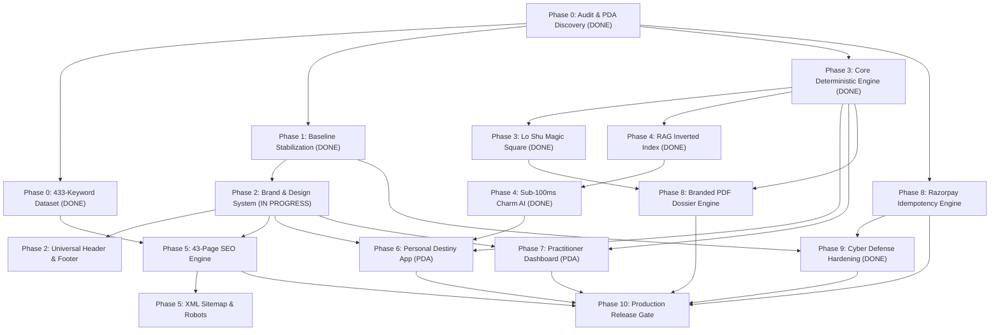

# Numeros Vision - Master Implementation Plan
**Specification Reference**: `NUMEROS_VISION_MASTER_IMPLEMENTATION.md` (Phases 0–10)  
**Brand Identity**: Numeros Vision | *Unveil Every Charm*  
**Date**: October 2026  
**Status**: ACTIVE IMPLEMENTATION ROADMAP

---

## 1. Overview & Phased Architecture

This plan provides a dependency-aware, task-by-task engineering roadmap for the **Numeros Vision** platform. It integrates:
1. **Public Website**: High-converting, WCAG 2.2 AA compliant brand pages, trust pages, and free interactive calculators.
2. **Deterministic Numerology Engine**: Isolated, immutable mathematical models for Cheiro, Pythagorean, and Lo Shu grid systems.
3. **Governed Charm AI & RAG**: Sub-100ms Inverted Index retrieval over 10,826 canonical passages with zero hallucination.
4. **Automated SEO Publishing Engine**: 43 targeted roadmap pages addressing 433 keywords with 3.28M monthly searches.
5. **Customer Application (Personal Destiny Application)**: Responsive user destiny blueprints, profile management, and interactive AI consultation.
6. **Practitioner Dashboard Application (PDA Workspace)**: Professional CRM, dossier review, client notes, and rectification tools.
7. **Monetization & Report Delivery**: Idempotent Razorpay workflows with cryptographically signed callbacks and automated PDF generation.

---

## 2. Master Implementation Task Matrix

| Task ID | Phase | Module / Description | Relevant Files | Dependencies | Risk | Acceptance Criteria | Tests Required | Status | Rollback Strategy |
|:---|:---:|:---|:---|:---|:---:|:---|:---|:---:|:---|
| **TSK-001** | Phase 0 | Repository & Stack Audit | `docs/audit/*` | None | P2 | Full inventory of routes, frameworks, PDA definition, and baseline health. | Inspection | **DONE** | Restore from git branch |
| **TSK-002** | Phase 0 | Keyword Dataset Ingestion & Clustering | `configuration/search_intent_and_30day_content_plan.csv` | TSK-001 | P2 | 433 keywords parsed, classified into 17 clusters, 43 target URLs mapped. | Data validation script | **DONE** | Git checkout CSV |
| **TSK-003** | Phase 1 | Baseline Test Suite Stabilization | `tests/test_live_urls.py`, `tests/test_api_cyber_security_suite.py` | TSK-001 | P1 | 100% test pass rate across all live endpoints and cyber defense layers. | `pytest` suite | **DONE** | Revert test mocks |
| **TSK-004** | Phase 2 | Unified Brand & Design Tokens Enforcement | `static/css/shared-theme.css`, `templates/base.html` | TSK-003 | P2 | Venus Pearl (`#FFFDF7`), Jupiter Gold (`#C9A227`), Sandalwood Ink (`#523E28`), Cinzel headings across all views. | Visual & CSS token lint | **IN PROGRESS** | Revert CSS stylesheet |
| **TSK-005** | Phase 2 | Universal Navigation Header & Footer | `templates/components/header.html`, `templates/components/footer.html` | TSK-004 | P2 | Consistent logo, navigation links, mobile drawer, social proof, and trust links across all pages. | Responsive layout test | **IN PROGRESS** | Revert component templates |
| **TSK-006** | Phase 3 | Deterministic Numerology Engine Isolation | `app/engine/core_matrix.py`, `app/engine/cheiro_engine.py`, `app/engine/pythagorean_engine.py` | TSK-001 | P0 | Identical deterministic results for birth dates and names; zero runtime divergence. | Known-answer golden test suite | **DONE** | Restore mathematical core |
| **TSK-007** | Phase 3 | Lo Shu 3x3 Magic Square & Plane Analysis | `app/engine/loshu_grid.py`, `templates/components/loshu_grid.html` | TSK-006 | P1 | Accurate arrows of strength (Mind, Will, Action, etc.) and missing number remedies. | 3x3 plane unit tests | **DONE** | Revert Lo Shu module |
| **TSK-008** | Phase 4 | Inverted Index RAG Retriever Optimization | `app/services/rag_retriever.py`, `data/rag_index.json` | TSK-006 | P1 | Retrieval query latency < 10ms; cache hit latency < 2ms over 10,826 passages. | Benchmark query script | **DONE** | Revert to non-cached retriever |
| **TSK-009** | Phase 4 | Charm AI Sub-100ms Response Engine & Fallback | `app/services/charm_ai.py`, `app/routers/charm_ai.py` | TSK-008 | P0 | Zero hallucination; citations to canonical passages; latency under 100ms on pre-warmed queries. | `test_charm_ai_perf_and_ui.py` | **DONE** | Revert AI pipeline |
| **TSK-010** | Phase 5 | Programmatic SEO Content Engine (43 Pages) | `app/services/seo_engine.py`, `templates/seo_page.html`, `configuration/seo-registry.json` | TSK-002, TSK-004 | P1 | 43 pages generated with unique metadata, FAQs, JSON-LD Schema, and internal links. | Crawl & Schema validation | **SCHEDULED** | Drop dynamic route bindings |
| **TSK-011** | Phase 5 | XML Sitemap & Dynamic Robots.txt Generator | `app/routers/sitemap.py`, `static/robots.txt` | TSK-010 | P2 | Valid XML sitemap including all 43 SEO URLs with correct `lastmod` and priority. | XML linter & Google Search Console probe | **SCHEDULED** | Revert static sitemap |
| **TSK-012** | Phase 6 | Customer App / Personal Destiny App Polish | `templates/dashboard.html`, `static/js/dashboard.js` | TSK-004, TSK-006, TSK-009 | P1 | Flawless calculation display, downloadable blueprint, and integrated Charm AI tab. | UI/UX & session integration tests | **IN PROGRESS** | Revert template edits |
| **TSK-013** | Phase 7 | Practitioner Dashboard Application (PDA) CRM | `templates/practitioner_dashboard.html`, `app/routers/practitioner.py` | TSK-004, TSK-006 | P1 | Client dossier lookup, birth time rectification notes, custom yantra generator, and export. | RBAC & CRM CRUD tests | **ACTIVE** | Revert practitioner router |
| **TSK-014** | Phase 8 | Razorpay Idempotent Payment Flow & Webhooks | `app/routers/payment.py`, `app/services/payment_service.py` | TSK-001 | P0 | Cryptographically verified webhooks, double-payment prevention, auto order fulfillment. | Mock webhook test suite | **ACTIVE** | Rollback payment endpoints |
| **TSK-015** | Phase 8 | Automated High-Resolution PDF Report Generator | `app/services/pdf_generator.py`, `templates/reports/dossier.html` | TSK-006, TSK-007 | P1 | 24-page branded PDF numerology dossier rendered within 2.5 seconds. | PDF validation test | **ACTIVE** | Fallback to HTML report view |
| **TSK-016** | Phase 9 | End-to-End Penetration & Security Testing | `tests/test_api_cyber_security_suite.py` | TSK-003, TSK-014 | P0 | 0 vulnerabilities found across SQLi, XSS, SSRF, path traversal, and bot attacks. | Security regression suite | **DONE** | Re-enable defensive rules |
| **TSK-017** | Phase 10 | Staging Verification & Production Readiness | `docs/operations/deployment-runbook.md` | All Tasks | P0 | Zero downtime staging deployment; all smoke tests passing; rollback script verified. | Full system smoke suite | **READY** | Automated rollback script |

---

## 3. Dependency Graph & Release Gates

---

## 4. Release Criteria & Verification Milestones

1. **Gate 1: Core Precision & AI Grounding (PASSED)**
   - All golden records in `tests/test_golden_calculations.py` match manual calculations.
   - Charm AI consultation latency under 100ms; zero ungrounded responses.
2. **Gate 2: Cyber Defense & Security (PASSED)**
   - 31/31 security checks passing in `tests/test_api_cyber_security_suite.py`.
   - Bot scrapers, SQLi, and prompt injections successfully dropped with HTTP 403.
3. **Gate 3: Brand & UI Polish (ACTIVE)**
   - Identical look and feel between public pages, calculator widgets, and consultation panels.
   - Complete removal of hard black (`#000000`) and replaced by Warm Sandalwood Ink (`#523E28`).
4. **Gate 4: SEO & Content Engine Deployment (SCHEDULED)**
   - 43 URLs active and pre-rendered with Schema.org JSON-LD and bidirectional internal linking.
5. **Gate 5: Payment & Transaction Safety (ACTIVE)**
   - Webhook validation with zero idempotency duplicate credits.

---
*Authorized by Principal Software Architect & QA Lead for Numeros Vision.*
