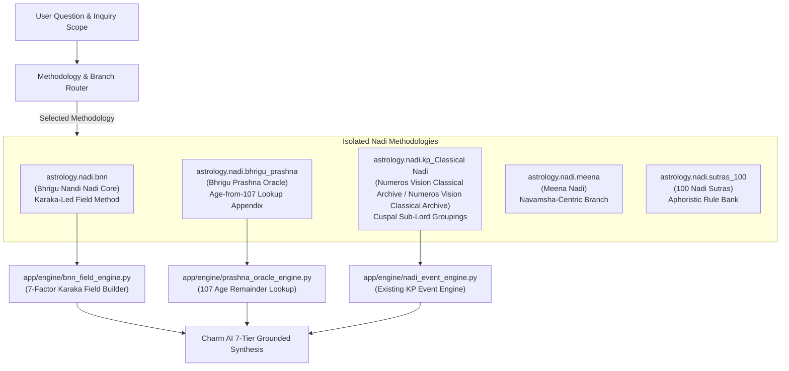

# NUMEROS VISION & CHARM AI — BNN & MULTI-BRANCH NADI ARCHITECTURE SPECIFICATION
**Document Version**: 1.1.0  
**Effective Date**: 2026-10-29  
**Primary Source Reference**: `Nadi Notes PDF Books Prediction.pdf` (Pages 1–18) & Addendum v1.1  
**Master Standard**: `Numeros_Vision_Google_Antigravity_Master_Implementation_v2.md`

---

## 1. Executive Summary & Purpose

This specification codifies the architectural blueprint for integrating **Bhrigu Nandi Nadi (BNN)** and multi-branch Nadi methodologies into **Numeros Vision** and **AI Charm**.

### Fundamental Software Finding
As verified from pages 1–18 of `Nadi Notes PDF Books Prediction.pdf`, the uploaded corpus does **NOT** represent a single unified textbook. It compiles multiple distinct Nadi traditions with fundamentally incompatible core mechanics:
1. **Bhrigu Nandi Nadi (BNN)**: A constitutional, karaka-led, field-based, case-law system where Ascendant (Lagna) is secondary, and the life topic's planetary karaka is primary.
2. **Bhrigu Prashna Nadi**: An indexed oracle manual organized into 107 fixed predictions, accessed by taking the native's completed age on the query date and subtracting it from 107 to locate a prediction page.
3. **KP-Nadi (Numeros Vision Classical Archive / Numeros Vision Classical Archive)**: A cuspal sub-lord house-grouping system (e.g., 2, 7, 11 for marriage; 2, 6, 10, 11 for career) operating on Placidus cusps and Krishnamurti Ayanamsa.
4. **Meena Nadi**: A Navamsha-centric Nadi tradition relying heavily on D9 divisional placements.
5. **100 Nadi Sutras**: An aphoristic rule collection providing supplementary, experimental sutras.

**Core Non-Negotiable Directives**:
- **Strict Isolation**: These branches must **NEVER** be merged into a single generic prediction algorithm.
- **BNN Karaka-First Authority**: BNN operates on topic karakas and planetary fields, not Lagna-based house slogans.
- **Prashna Age Lookup Walled Off**: The "age subtracted from 107" formula is walled off exclusively into an optional specialty Prashna appendix (`nadi.prashna.bhrigu_107`) and must never govern natal readings.
- **Zero Hallucinated Precision**: Broad transit corridors and age bands must never be manufactured into false day-level dates or absolute certainties.

---

## 2. Multi-Branch Nadi Software Taxonomy



| Branch Namespace | Core Operational Mechanism | Source Provenance | Allowed Scope & Guardrails |
| :--- | :--- | :--- | :--- |
| `astrology.nadi.bnn` | Karaka-first, 7-factor field analysis, planetary rounds, case-law | `Nadi Notes` pp. 6–18, BNN course texts | **PRIMARY NATAL NADI ENGINE**. Governs career ecology, marriage phases, transit corridors. |
| `astrology.nadi.bhrigu_prashna` | Age subtracted from 107 remainder lookup; Yoga-Dosha-Remedy triad | `Nadi Notes` pp. 1–5 | **SPECIALTY APPENDIX ONLY**. Explicit user opt-in for rapid oracle pulls; never used for natal charts. |
| `astrology.nadi.kp_Classical Nadi` | Cuspal sub-lord house combinations (2, 7, 11; 6, 8, 12, etc.) | Numeros Vision Classical Archive (277 pp), Numeros Vision Classical Archive | Preserved as existing `nadi_event_engine.py`; strictly isolated from BNN karakatwas. |
| `astrology.nadi.meena` | Navamsha-centric planetary evaluation | Meena Nadi texts | Requires D9 divisional calculations; unconfigured until primary source verified. |
| `astrology.nadi.sutras_100` | Standalone aphoristic rules | 100 Nadi Sutras | Supplementary experimental rule bank; each sutra tagged with review state. |

---

## 3. The 7-Factor BNN Karaka-First Analysis Engine

### Operational Law 1: Lagna is Secondary, Topic Karaka is Primary
In standard Parashari astrology, interpretation begins at the 1st House (Lagna). In **Bhrigu Nandi Nadi**, interpretation begins at the **Topic Karaka** (significator planet) for the life inquiry:

| Life Domain / Inquiry | Primary BNN Topic Karaka | Secondary Modifiers & Significations |
| :--- | :--- | :--- |
| **Profession, Career, Work, Karma** | **Saturn** (`Shani`) | Sun (Govt/Admin), Mars (Engineering/Tech), Mercury (Accounts/Trade), Venus (Finance/Arts), Rahu (Foreign/Tech) |
| **Life Force, Self, Dharma, Children** | **Jupiter** (`Guru` / `Jeeva`) | Moon (Mind/Emotions), Sun (Soul/Status), Venus (Progeny/Comforts) |
| **Marriage, Spouse, Luxury, Vehicles** | **Venus** (`Shukra`) | Mars (Husband in female chart), Jupiter (Honor), Moon (Emotional peace), Ketu (Separation/Detachment) |
| **Intellect, Education, Commerce, Law** | **Mercury** (`Budh`) | Jupiter (Wisdom/Higher Education), Saturn (Struggle/Discipline), Mars (Logic/Debate) |
| **Siblings, Property, Surgery, Conflict** | **Mars** (`Mangal`) | Saturn (Construction/Labor), Ketu (Surgery/Sharp instruments), Sun (Courage) |
| **Father, Government Authority, Soul** | **Sun** (`Surya`) | Jupiter (Honor/Nobility), Saturn (Father's karma/delay) |
| **Mother, Travel, Mental Peace, Relocation** | **Moon** (`Chandra`) | Rahu (Foreign travel/Restlessness), Venus (Domestic comfort) |
| **Karmic Triggers, Foreign Roots, Distortions** | **Rahu** & **Ketu** | Act as directional deflectors, holy-place markers, or karmic accelerators. |

---

### Operational Law 2: The 7-Factor Planetary Field Evaluation
To evaluate any life inquiry, the deterministic engine must calculate the complete **Planetary Field** around the topic karaka:

```
                  [Factor 2: Sign Lord (Dispositor)]
                                  │
                                  ▼
[Factor 5: 12th from Karaka] ──► [Factor 1: TOPIC KARAKA] ◄── [Factor 3: Co-Tenants]
(Dissolution / Prior Cause)      (Sign & Exact Degree)         (Planets sharing Sign)
                                  │
                                  ├──────────────────────────┐
                                  ▼                          ▼
                   [Factor 4: 7th from Karaka]   [Factor 6: Parivartana Exchange]
                   (Direct Aspect / Polarity)    (Sign Lord Mutual Exchange)
                                  │
                                  ▼
                 [Factor 7: Jupiter & Saturn Transits]
                 (Corridor Timing & Contact Sequences)
```

1. **Factor 1: Sign Occupied by Karaka**: Elemental nature (Fire, Earth, Air, Water) and directional alignment (East, South, West, North).
2. **Factor 2: Sign Lord (Dispositor)**: Where the ruler of the sign is placed, indicating the underlying support and ultimate destination of the topic.
3. **Factor 3: Co-Tenants**: Other planets occupying the exact same sign. Modifies the primary planet's expression (e.g. Saturn + Mars vs. Saturn + Mercury).
4. **Factor 4: 7th Planet (Opposition / Mutual Aspect)**: Planets situated directly opposite (in the 7th sign from the karaka). Imposes reciprocal influence, public reflection, or partnership friction.
5. **Factor 5: 12th Planet (Preceding Sign)**: Planets situated in the 12th house from the karaka. Represents preceding causes, expenditures, hidden drains, or foundational backstory.
6. **Factor 6: Parivartana Yoga (Sign Exchange)**: If Planet A is in Planet B's sign, and Planet B is in Planet A's sign, the planets exchange energy. **BNN considers exchange a radical redirector of results**, allowing a planet to behave as if occupying its own domicile.
7. **Factor 7: Transit Timing Corridors**: Jupiter and Saturn transits activating the natal placement, 5th/9th trines, or 7th opposition.

---

## 4. Dedicated Career & Job Ecology Intelligence Module

Pursuant to Section 5 of the BNN Addendum and page 16 of `Nadi Notes`:
BNN does not flatten career into a generic "good/bad" score. It evaluates **Job Ecology** by analyzing the planetary network anchored on **Saturn**:

| Documented BNN Planetary Network | Primary Job Ecology & Sector | Real-World Occupational Families |
| :--- | :--- | :--- |
| **Saturn + Sun (+ Jupiter)** | Government & Public Administration | Civil services, institutional governance, public sector leadership, statutory bodies |
| **Saturn + Mars (+ Mercury/Ketu)** | Engineering, Technology & Machinery | Software engineering, mechanical systems, hardware, construction, technical operations |
| **Saturn + Mercury (+ Venus)** | Commercial, Accounts & Financial Treasury | Chartered accountancy, banking, corporate finance, audits, trading, commercial analysis |
| **Saturn + Mercury (+ Mars/Jupiter)** | Legal & Jurisprudence | Corporate counsel, litigation, statutory compliance, arbitration, intellectual property |
| **Saturn + Mars + Ketu (+ Moon/Sun)** | Healthcare, Pharmaceuticals & Surgery | Medicine, chemical research, surgical instruments, pharmacy, medical technology |
| **Saturn + Mercury (+ Jupiter)** | Educational & Academic Institutions | University professors, academic directors, research scholars, institutional trainers |
| **Saturn + Venus (+ Moon/Rahu)** | Creative, Media, Luxury & Glamour | Design, luxury hospitality, cinema/media, aesthetics, digital arts, entertainment |
| **Saturn + Moon (+ Rahu)** | Transport, Logistics & Global Mobility | Aviation, maritime, supply chain, international freight, travel networks |

### Strict Practical Career Safeguards
- **Zero Career Abandonment**: An astrological reading must **NEVER** advise a user to resign from their job, abandon university education, or liquidate assets for a speculative business venture.
- **Contextual Real-World Separation**: Traditional planetary indications must be explicitly presented alongside real-world skills, qualifications, market conditions, financial runway, and user goals.

---

## 5. BNN Corridor Timing Analysis

BNN calculates time using **Planetary Rounds and Contact Sequences**, not arbitrary day-level predictions:

```
[Jupiter 12-Year Round (Jeeva Fruit)] ──► Touches Natal Field Planets at Ages ~12, 24, 36, 48, 60
[Saturn 30-Year Round (Karma Shift)]  ──► Touches Natal Field Planets at Ages ~30, 60
```

1. **Jupiter Rounds (12-Year Cycle)**:
   - Round 1: Ages 1 to 12 (Childhood / Early foundation)
   - Round 2: Ages 13 to 24 (Education / Identity / Entry into work)
   - Round 3: Ages 25 to 36 (Career acceleration / Marriage / Family foundation)
   - Round 4: Ages 37 to 48 (Executive stability / Expansion / Status peak)
   - Round 5: Ages 49 to 60 (Maturity / Legacy / Wealth consolidation)
2. **Saturn Rounds (30-Year Cycle)**:
   - 1st Return (~Age 28–30): Major structural shift in responsibility, career transition, or karmic awakening.
   - 2nd Return (~Age 58–60): Consolidating career accomplishments and entering mentorship or post-institutional phase.
3. **Strict Abstention Standard on Exact Dates**:
   - BNN transit indications yield **age bands and transit corridors (e.g. 6–18 month windows)**.
   - The engine must **NEVER** manufacture a specific date (e.g. "You will be hired on November 14th") from a broad planetary transit.

---

## 6. Case-Law & Analogical Pattern Matching Engine

BNN is inherently case-driven. A single illustrative example in an ancient text cannot be promoted to an absolute universal law.

Every BNN rule record in `data/knowledge_base/bnn_case_library.json` must adhere to the schema:
```json
{
  "case_id": "BNN-CASE-001",
  "topic": "profession_engineering",
  "natal_configuration": {
    "saturn_sign": "Aries",
    "mars_sign": "Leo",
    "mercury_sign": "Sagittarius"
  },
  "field_relationship": "Saturn in fiery trine with Mars and Mercury",
  "source_event_claim": "Native worked as electrical/mechanical engineer",
  "author_stated_reasoning": "Saturn connected to Mars (machinery) and Mercury (technical intellect) in fiery signs",
  "analyst_inference": "Fiery trines link technical intellect with industrial enterprise",
  "known_exceptions": ["If Ketu aspects Mars, work shifts to spiritual architecture or coding"],
  "provenance": {
    "source_id": "SRC-NADI-NOTES-2026",
    "pdf_page": 16,
    "review_status": "human_reviewed"
  }
}
```

---

## 7. Evidence, Safety & Non-Fear-Based Remedy Safeguards

Pursuant to Section 0 Rule 10 and Addendum Section 9:
1. **Zero Past-Life Guilt Shaming**: Traditional texts sometimes explain difficulties through previous-birth karma or curses. These are preserved strictly as **historical/doctrinal context** and must **NEVER** be presented to a user as literal proof that their current suffering is due to moral wrongdoing.
2. **No Fatalistic Claims**: Zero predictions of death, terminal illness, divorce, or bankruptcy.
3. **Non-Coercive Remedies**:
   - Traditional remedies (mantras, charitable donations, reflective fasts) are strictly **optional**.
   - Zero claims that purchasing a gemstone, ritual, or report will guarantee an outcome or ward off a catastrophe.
   - Grounded practical guidance (skill development, networking, financial planning) must always be provided alongside traditional reflections.

---

## 8. Phase-by-Phase Implementation Roadmap

- [x] **Phase A: Complete System Audit & Baseline Specification** (Current Phase)
  - Full inventory of all 42 files across storage directories.
  - Rights classification in `SOURCE_RIGHTS_REGISTER.md`.
  - Cryptographic duplicate audit in `DUPLICATE_AND_VERSION_REPORT.md`.
  - Text extraction quality assessment in `EXTRACTION_QUALITY_REPORT.md`.
  - Comprehensive BNN architecture blueprint in `NADI_BNN_ARCHITECTURE_SPECIFICATION.md`.
- [ ] **Phase B: Isolated Registry & Feature-Flagged Scaffolding**
  - Implement `app/engine/bnn_field_engine.py` behind feature flag `ENABLE_BNN_MODULE=False`.
  - Define `data/knowledge_base/bnn_rule_registry.json`.
- [ ] **Phase C: Karaka Field Builder & Saturn Career Pipeline**
  - Implement 7-factor field calculator (sign, lord, co-tenants, 7th/12th, parivartana).
  - Implement Saturn job ecology module with 8 occupational families.
- [ ] **Phase D: Transit Timing Corridors & Jupiter/Saturn Rounds**
  - Implement contact sequence and age-band calculations.
  - Enforce strict date-manufacturing abstention gates.
- [ ] **Phase E: Charm AI & Report Integration**
  - Wire BNN outputs to Charm AI 7-tier response structure.
  - Implement evidence validation and publication gate.
- [ ] **Phase F: Regression Testing & Production Rollout**
  - Run full test suite, verify zero regression on existing numerology engines, and commit verified release.
